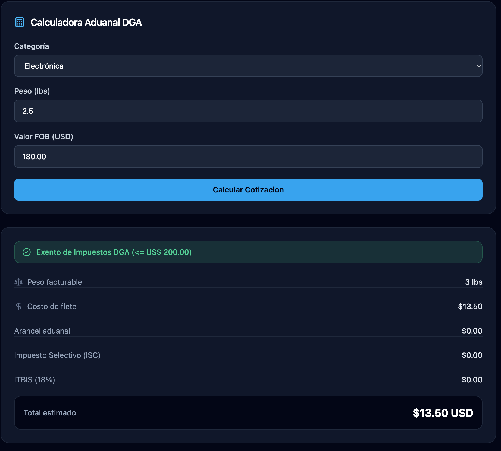
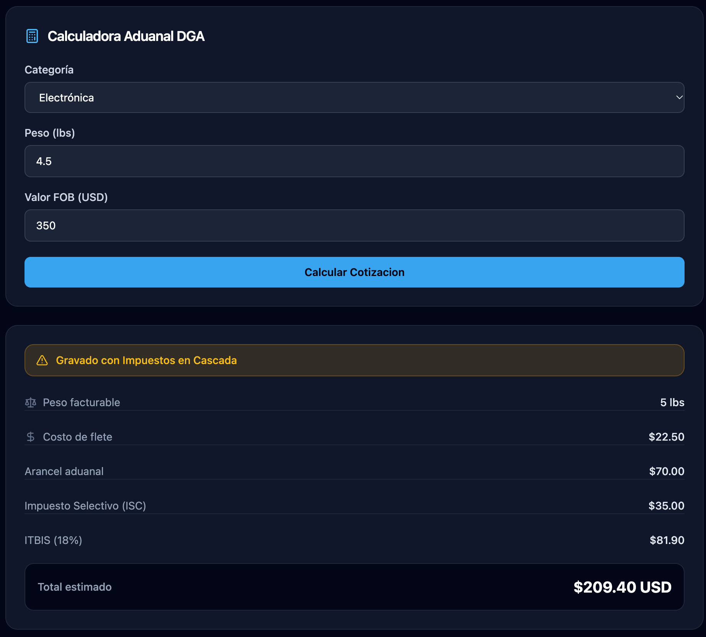
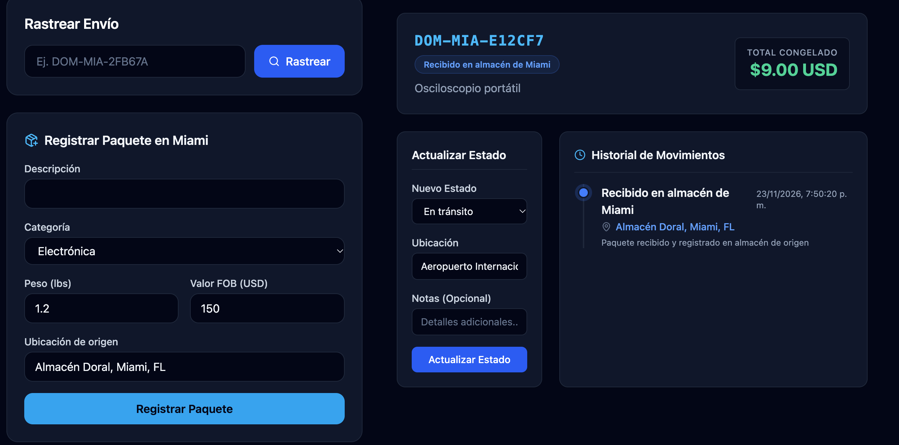
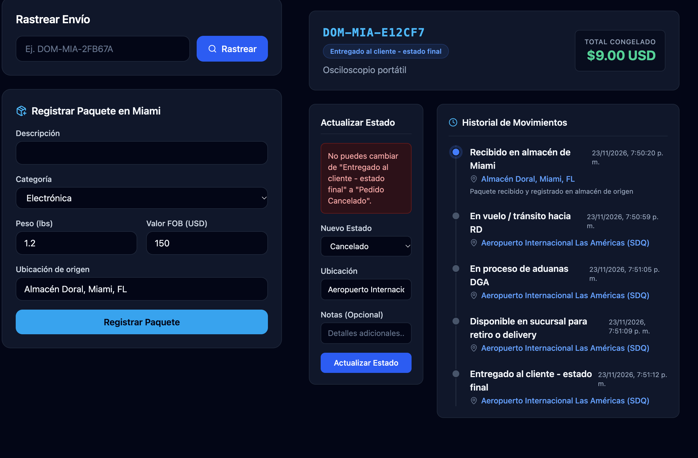

<div align="center">

# Courier Logistics Web — Cotizador DGA & Rastreo (MIA → RD)

**Simulador de liquidación aduanal (Decreto 402-05) y rastreo logístico en tiempo real para la ruta Miami (MIA) → Santo Domingo / La Romana (SDQ / LRM).**

[](https://react.dev)
[](https://typescriptlang.org)
[](https://tailwindcss.com)
[](https://vitejs.dev)
[](#)

[Backend API REST](https://github.com) • [Funcionalidades](#funcionalidades-principales) • [Capturas](#capturas-de-pantalla) • [Endpoints](#endpoints-de-la-api) • [Tecnologías](#tecnologías) • [Instalación](#instalación-y-ejecución-local)

</div>

---

## Funcionalidades Principales

* **Calculadora Aduanal DGA en Vivo:**
    * Evaluación automática de exención fiscal (**≤ US\$ 200.00 FOB**) vs. liquidación con impuestos en cascada (**Arancel + ISC + ITBIS 18% sobre valor CIF**).
    * Validación reactiva por campo sincronizada con las respuestas `400 Bad Request` del backend.
* **Rastreo y Gestión Logística (`DOM-MIA-XXXXXX`):**
    * Registro de paquetes recibidos en el almacén de Miami con congelamiento automático de flete e impuestos (*frozen cost snapshot*).
    * Búsqueda instantánea por código de tracking y línea de tiempo cronológica de eventos.
    * Control de máquina de estados (`RECEIVED_MIAMI` → `IN_TRANSIT` → `CUSTOMS_CLEARANCE` → `READY_FOR_PICKUP` → `DELIVERED`) con alertas visuales ante transiciones ilegales (`409 Conflict`).

---
## Capturas de Pantalla

### 1. Calculadora Aduanal DGA (Decreto 402-05)
Comparativa entre un envío exento de impuestos (≤ US\$ 200.00 FOB) y un envío gravado con cálculo de impuestos en cascada (Arancel + ISC + ITBIS):

| Envío Exento (`≤ US$ 200.00 FOB`) | Envío Gravado (`> US$ 200.00 FOB`) |
| :---: | :---: |
|  |  |

### 2. Gestión de Almacén, Tracking y Control de Estados
Registro en Miami con tarifa congelada (*Total Congelado*), línea de tiempo cronológica y bloqueo de transiciones inválidas (`409 Conflict` al intentar cancelar un paquete ya entregado):

| Registro y Tracking Inicial | Historial Completo y Alerta `409 Conflict` |
| :---: | :---: |
|  |  |

## Endpoints de la API

Base URL por defecto: `http://localhost:8080/api/v1`

| Método | Endpoint | Descripción | Códigos de Respuesta |
| :--- | :--- | :--- | :--- |
| `POST` | `/quotes/calculate` | Calcula el peso facturable, flete e impuestos DGA (Arancel, ISC, ITBIS) según categoría y valor FOB. | `200 OK`, `400 Bad Request` |
| `POST` | `/packages` | Registra un paquete en el almacén de Miami, genera su tracking (`DOM-MIA-XXXXXX`) y congela el costo total. | `201 Created`, `400 Bad Request` |
| `GET` | `/packages/{trackingCode}` | Consulta el estado actual, costo congelado e historial cronológico de movimientos de un paquete. | `200 OK`, `404 Not Found` |
| `PATCH` | `/packages/{trackingCode}/status` | Actualiza el estado logístico y registra ubicación/notas validando la máquina de estados. | `200 OK`, `400 Bad Request`, `409 Conflict` |

---

## Tecnologías

* **Core:** React 19 + TypeScript 5 (tipado estricto de contratos DTO y enums)
* **Estilos e Iconografía:** Tailwind CSS v4 + Lucide React
* **Build Tool:** Vite

---

## Arquitectura del Sistema

```text
┌─────────────────────────────┐      REST / JSON      ┌─────────────────────────────┐
│    courier-logistics-web    │ ◄───────────────────► │    courier-logistics-api    │
│ (React 19 + TS + Tailwind)  │ DTOs / 400 / 409 Han. │    (Backend Lógica DGA)     │
└─────────────────────────────┘                       └─────────────────────────────┘
```

---

## Instalación y Ejecución Local

### Prerrequisitos
* **Node.js** `v18+` y `npm` instalados.
* Tener corriendo el servidor backend ([WilfredoAM22/courier-logistics-api](https://github.com)).

### Pasos

1. **Clonar el repositorio e instalar dependencias:**
   ```bash
   git clone https://github.com
   cd courier-logistics-web
   npm install
   ```

2. **Configurar variables de entorno:** *(Opcional: por defecto apunta a `http://localhost:8080/api/v1`)*
   ```bash
   echo "VITE_API_URL=http://localhost:8080/api/v1" > .env.local
   ```

3. **Levantar el servidor de desarrollo:**
   ```bash
   npm run dev
   ```

---

## Estructura de Referencia

```text
src/
├── components/   # Calculadora DGA, Timeline de tracking y modales de estado
├── types/        # Contratos DTO, respuestas de error (400/409) y enums
├── services/     # Cliente HTTP conectado a VITE_API_URL
└── App.tsx       # Vista principal y enrutamiento de flujos
```

---

## Autor

**Wilfredo Alexis**  
Desarrollador Full Stack  
[](https://github.com)
